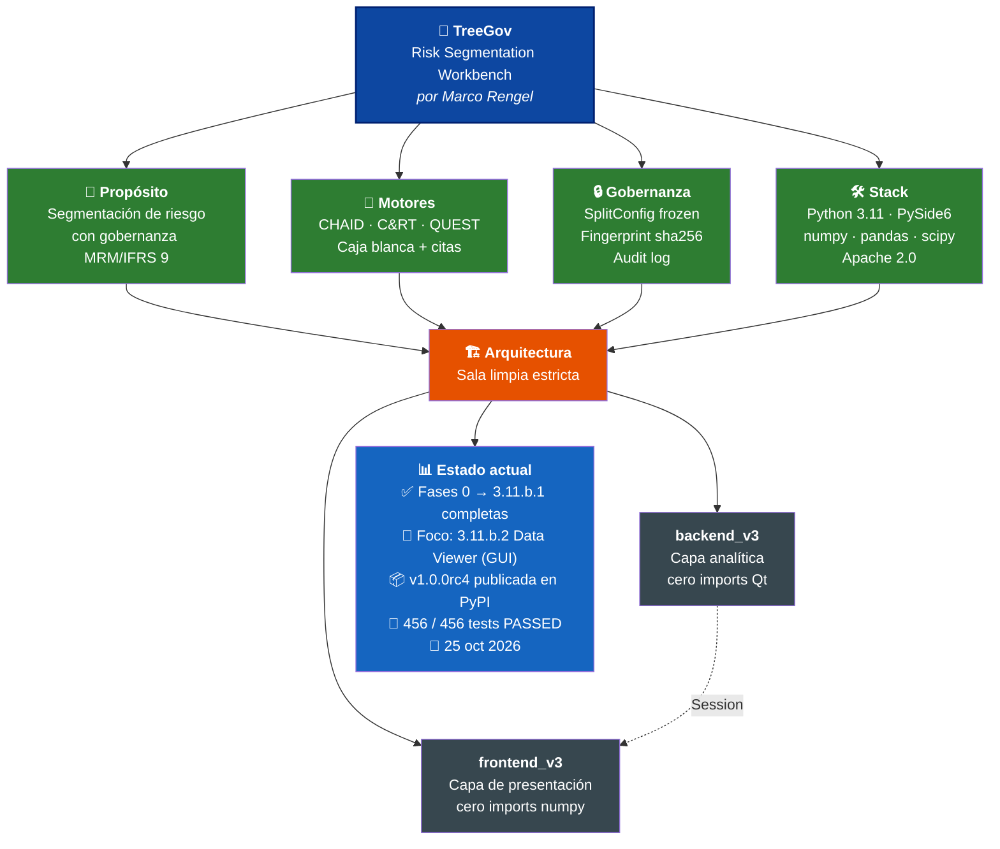

# TreeGov — Risk Segmentation Workbench

**Versión**: 1.0.0rc4
**Autor**: Marco Rengel
**Licencia**: Apache 2.0
**Motor gráfico**: PySide6
**Motor analítico**: Python (NumPy, pandas, scipy.stats)
**Suite de tests**: 449/449 passing

> ⚠️ **Aviso regulatorio.** TreeGov está en fase de validación técnica (Model Risk Management - MRM). **Uso restringido: validación técnica MRM. No apto para producción bancaria sin aprobación regulatoria.** Cualquier uso en un entorno productivo regulado (bancario o de otro tipo) requiere validación independiente, aprobación formal e integración con el marco de gobierno de modelos de la institución.

**Ámbito de datos.** TreeGov se desarrolla exclusivamente con *datasets* públicos (German Credit, UCI) y datos sintéticos. Está diseñado para uso final con datos bancarios reales en el escritorio del analista: el CSV nunca sale del equipo. Durante el desarrollo no se envían datos reales a APIs de IA de terceros. Cuando TreeGov se use en producción con datos reales, los *logs* DEBUG y los *reports* HTML exportados contienen información sensible del modelo (PD por nodo, conteos por segmento, nombres de columnas reales, rutas de archivo) y deben tratarse como material confidencial por parte del analista.

---

## Resumen ejecutivo

TreeGov es una plataforma *open source* para construir, validar y auditar modelos basados en árboles de decisión en entornos regulados. Nace como heredera de las herramientas GUI clásicas (hoy discontinuadas) que permitían a los analistas construir modelos sin programar. A diferencia de las suites corporativas cerradas, TreeGov democratiza la gobernanza de modelos (MRM) y el cumplimiento de estándares como Basilea e IFRS 9.

El sistema implementa CHAID (clásico y Exhaustive), C&RT y QUEST con matemática de caja blanca: cada fórmula estadística está escrita explícitamente y citada a su publicación original. La gobernanza es *opt-out* a través de dos modos explícitos. El Modo Regulatorio (por defecto) aplica la capa completa de MRM requerida por bancos y burós de crédito: estimador de Jeffreys, PD floor (BCBS CRE 32.4) y huellas criptográficas que registran la elección. El Modo Investigación produce probabilidades empíricas crudas, abriendo la herramienta a dominios como salud, biología o ciencias sociales. La elección es siempre explícita y nunca silenciosa.

Las librerías tradicionales (*scikit-learn*, *statsmodels* o paquetes de R) exigen escribir código, lo que resta tiempo al análisis. Por otro lado, las herramientas visuales que existieron en el pasado fueron discontinuadas. TreeGov llena ese vacío combinando un entorno visual de código abierto con la trazabilidad regulatoria (SR 11-7, Basilea, IFRS 9) como principio de diseño fundamental.

---

## Filosofía

> «Python le da el motor. TreeGov le da el motor, el freno, el tablero, el cinturón de seguridad y el registro de mantenimiento. ¿Cuál prefiere para un modelo que va a ser auditado por el regulador?»

TreeGov parte de una premisa: la gobernanza de modelos no es una capa que se añade al final, sino un principio que se teje en cada componente. Mientras que las librerías estadísticas y los entornos de *scripting* ofrecen el motor analítico, TreeGov ofrece además el freno (controles MRM), el tablero (visualización gráfica), el cinturón de seguridad (auditabilidad) y el registro de mantenimiento (bitácora inmutable). Para un modelo que será auditado por un regulador, la elección no es técnica: es de gobernanza.

Más allá de usar MRM dentro de la herramienta, **el software en sí mismo se construye bajo disciplina MRM**: auditoría de diseño antes del código, supervisión humana en el circuito, verificación adversarial y trazabilidad inmutable para cada release.

TreeGov es un **desarrollo Clean Room**: una reimplementación matemática moderna derivada exclusivamente de papers académicos (Kass, Breiman, Loh & Shih) y del estándar clásico de estaciones de árboles documentado (circa 2001). Toda su lógica es de caja blanca, garantizando la independencia algorítmica y la máxima auditabilidad (`docs/design_decisions.md` §0.5).

*Lee la filosofía completa → [Español](https://github.com/Marco-Rengel/treegov/blob/main/docs/philosophy.es.md) · [English](https://github.com/Marco-Rengel/treegov/blob/main/docs/philosophy.md)*



---

## ¿Qué es TreeGov?

TreeGov es una estación de trabajo analítica para construir, evaluar y auditar árboles de decisión en entornos regulados. A diferencia de las librerías de *machine learning*, donde el analista opera en una caja negra, TreeGov proporciona un entorno visual con matemática explícita y trazabilidad absoluta.

La característica principal de TreeGov es la auditabilidad radical. Absolutamente todo el ciclo de vida del modelo puede ser rastreado por un auditor:
*   El código: cada fórmula estadística está escrita explícitamente y citada a su publicación original.
*   Las decisiones: la arquitectura y los *trade-offs* están documentados para justificar cada elección.
*   El modelo: cada entrenamiento genera un *fingerprint* (huella) único que actúa como sello inmutable.
*   La evidencia: una bitácora transaccional registra cada paso, y una suite de más de 400 pruebas (incluyendo *datasets* públicos validados) garantiza la reproducibilidad de los resultados.

---

## Principios de diseño

1. **Arquitectura de sala limpia**: separación estricta entre el backend analítico (`backend_v3/`, sin dependencias de GUI) y la capa de presentación (`frontend_v3/`, sin lógica analítica).
2. **Caja blanca**: prohibido el uso de *sklearn*, *statsmodels* o cualquier librería de caja negra. Cada fórmula estadística está escrita explícitamente en el código, con su cita bibliográfica.
3. **Gobernanza nativa**: logging transaccional DEBUG, configuración inmutable (*SplitConfig frozen*), y validación de invariantes matemáticos en la construcción.

---

## Capacidades analíticas

| Capacidad | Referencia | Anclaje regulatorio | Características clave |
|---|---|---|---|
| **CHAID** clásico y Exhaustive | Kass (1980); Biggs et al. (1991) | — | Fusión iterativa de categorías con corrección de Bonferroni, soporte multiclase, regla de Cochran |
| **C&RT** | Breiman et al. (1984) | — | Impureza de Gini / varianza, *surrogate splits*, multiclase (K ≥ 2) |
| **QUEST** | Loh & Shih (1997) | — | Selección insesgada de variable, corte QDA para K=2, barrido de Gini para K > 2 (enfoque híbrido C&RT/QUEST para multiclase) |
| **Soporte Multiclase** | Hand & Till (2001) | — | Entrenamiento y métricas para K ≥ 2 clases; Gini multiclase y KS por pares |
| **Ponderación por muestra** | Heeringa et al. (2010) | SR 11-7 | Ajuste de sesgo muestral en motores, construcción del árbol, métricas de validación y monitoreo de estabilidad. Limitación conocida: el split train/test estratifica por conteo físico de filas (no por masa ponderada) y el agreement de surrogates en C&RT no está ponderado (design_decisions.md §13.3, §13.6.2). El Gini/KS/AUC global de la gains table binaria SÍ está ponderado desde la resolución de D13 (20/10/2026; ver design_decisions.md §13.7). |
| **Categorías de población** | — | — | Filtro *opt-in* para excluir categorías (Indet, No Perf) antes del entrenamiento |
| **Estimador de Jeffreys + PD Floor** | Jeffreys (1946) | BCBS CRE 32.4 | Mitigación de probabilidades nulas en carteras de bajo impago |
| **Partición Hamilton-Hare** | — | — | *Split* train/test estratificado exacto, sin sesgo de redondeo |
| **Imputación anti-leakage** | — | SR 11-7 | Estadísticos ajustados solo sobre train (`TrainOnlyImputer`) |
| **Poda coste-complejidad** | Breiman et al. (1984) | — | Post-poda con la secuencia alpha; reindexado determinista de nodos. Interactiva y ponderada (Fase 3.9): error ponderado `r_w(t)` cuando el árbol lleva pesos de muestra, expuesta vía `Session.get_prune_sequence()` y el diálogo `PruneDialog` de la GUI. |
| **Validación Out-of-Sample (OOS) / Out-of-Time (OOT)** | Hanley & McNeil (1982); Hosmer & Lemeshow (1980) | Basilea; SR 11-7 | Gini, KS, HL, Brier, ROC/AUC, PR-AUC; cohorte *out-of-time* |
| **Monitoreo de estabilidad** | Siddiqi (2006) | Basilea / EBA | Population Stability Index (PSI, hojas), Characteristic Stability Index (CSI, covariables), Gini Drop con semáforos |
| **Validación con datasets UCI** | UCI ML Repository | — | Reproducibilidad anclada a 6 *datasets* (German Credit, Breast Cancer, etc.) |

---

## Stack tecnológico

- Python 3.11 / 3.12
- PySide6 (interfaz gráfica)
- numpy, pandas, scipy.stats (cálculo estadístico)
- pyarrow, openpyxl (ingesta de datos)
- pytest (opcional: los tests son ejecutables con python directo)

---

## Estructura del repositorio

```
TreeGov/
├── backend_v3/              # Capa analítica pura (0 imports Qt)
│   ├── import_guard.py      # Bloqueo de librerías de caja negra
│   ├── log_config.py        # Logger transaccional DEBUG
│   ├── types.py             # SplitConfig (frozen) + enums
│   ├── statistics.py        # chi2, F, Brown-Forsythe, Stirling, Kass
│   ├── imputation.py        # TrainOnlyImputer (anti-leakage)
│   ├── chaid_engine.py      # CHAID clásico + Exhaustive
│   ├── crt_engine.py        # C&RT multiclase + surrogate splits
│   ├── quest_engine.py      # QUEST multiclase + QDA/Gini
│   ├── splitting.py         # Partición Hamilton-Hare
│   ├── profiling.py         # Inferencia de tipos de predictor
│   ├── tree_builder.py      # Construcción BFS + TreeModel
│   ├── session_state.py     # Máquina de estados (EMPTY a TRAINED a OOT)
│   ├── validation.py        # Métricas OOS + evaluación OOT
│   ├── pruning.py           # Poda coste-complejidad (Breiman)
│   ├── reporting.py         # DTOs de gains table + matriz de clasificación
│   └── stability.py         # PSI / CSI / Gini Drop
├── frontend_v3/             # Capa de presentación (Fase 2)
├── tests/                   # Tests unitarios (dual: pytest / python directo)
├── docs/                    # Documentación
│   ├── methodology.md       # Metodología matemática (EN)
│   ├── design_decisions.md  # Decisiones de implementación (EN)
│   ├── 3.1_design_multiclass.md  # Diseño Fase 3.1 (EN)
│   ├── 3.2_decisions_consolidated.md  # Decisiones Fase 3.2 (EN)
│   ├── 3.3_design_population_categories.md  # Diseño Fase 3.3 (EN)
│   ├── 3.4_design_multiclass_crt_quest.md  # Diseño Fase 3.4 (EN)
│   ├── 3.5_design_multiclass_weighted_reports.md  # Diseño Fase 3.5 (EN)
│   ├── 3.6_design_public_datasets.md  # Diseño Fase 3.6 (EN)
│   ├── 3.7_design_pre_release_fixes.md  # Diseño Fase 3.7 (EN)
│   ├── 3.8_design_regulatory_attribution.md  # Diseño Fase 3.8 (EN)
│   ├── 3.9_design_interactive_weighted_pruning.md  # Diseño Fase 3.9 (EN)
│   ├── 3.10.a_design_ux_ui_redesign.md  # Diseño Fase 3.10.a + as-built (EN)
│   ├── 3.10.b_design_chaid_binning.md  # Diseño Fase 3.10.b + as-built (EN)
│   ├── 3.11_design_interactive_tree.md  # Diseño Fase 3.11 (EN)
│   ├── 3.11.a_design_colab_theme.md  # As-built Fase 3.11.a (EN)
│   ├── 3.11_classic_tree_ui_reference.md  # Referencia visual de estación de árboles clásica, circa 2001 (ES)
│   ├── validation_results_3.6.md  # Informe de validación UCI (EN)
│   ├── security_audit.md      # Auditoría de seguridad y privacidad (EN)
│   ├── playbook.md          # Playbook de gobernanza (EN)
│   ├── api.md               # API pública (EN)
│   ├── roadmap.md           # Plan de fases (EN)
│   ├── philosophy.md        # Filosofía (EN)
│   ├── philosophy.es.md     # Filosofía (ES)
│   ├── estado_proyecto.md   # Dossier de estado del proyecto (ES)
│   ├── audit_log.md         # Bitácora de auditoría (ES)
│   ├── contexto_para_nueva_sesion.md  # Bootstrap entre sesiones (ES)
│   └── prompt_para_asistente.md       # Brief para asistentes IA (ES)
├── archive/                 # Documentos históricos (solo lectura)
├── data/                    # Datasets (solo lectura, Git-ignored)
├── logs/                    # Logs por corrida (Git-ignored)
├── treegov.py               # Orquestador headless (CLI)
├── treegov_gui.py           # Entry point de la GUI (Fase 2)
├── pyproject.toml           # Empaquetado
├── requirements.txt         # Mínimos de trabajo (pyproject.toml es la fuente oficial)
├── opencode.json            # Configuración del proyecto OpenCode
├── README.md                # README principal (EN)
├── README.es.md             # Este archivo (ES)
├── AGENTS.md                # Instrucciones operativas para agentes IA
├── CONVENTIONS.md           # Convenciones operativas para Aider
├── LICENSE                  # Apache 2.0
├── NOTICE.md                # Aviso legal y atribución
├── .gitignore               # Exclusiones de Git
├── .aiderignore             # Exclusiones del repo-map de Aider
├── .gitattributes           # Normalización de line endings
├── .aider.conf.example.yml  # Plantilla de configuración de Aider
└── .treegovrules            # Reglas de gobernanza para agentes IA
```

---

## ¿Por qué TreeGov?

| Si necesita... | Utilice... |
|---------------------------------|---------------------|
| Decenas o cientos de algoritmos ML | *scikit-learn* |
| Aprendizaje profundo | *PyTorch* o *TensorFlow* |
| Potenciación del gradiente | *XGBoost* o *LightGBM* |
| **Árboles auditables con gobernanza MRM** | **TreeGov** |

---

## Inicio rápido

### Instalación

```powershell
.\.venv\Scripts\python -m pip install -r requirements.txt
```

### Demo headless (Fase 0)

```powershell
.\.venv\Scripts\python treegov.py
```

### Benchmark de rendimiento (N=1M)

```powershell
.\.venv\Scripts\python tests\benchmark_1m.py --n 1000000 --seed 42
```

### Suite de tests

```powershell
.\.venv\Scripts\python -m pytest tests -q
```

---

## Estado del proyecto

| Fase | Descripción | Estado |
|---|---|---|
| **0** | Núcleo algorítmico: 4 motores + statistics + imputación | Completada |
| **1** | Flujo transaccional: splitting, profiling, tree_builder, session_state | Completada |
| **1.2** | Evaluación OOS + poda coste-complejidad | Completada |
| **1.3** | Validación OOT + monitoreo PSI/CSI | Completada |
| **2.0-2.2** | GUI con PySide6: esqueleto, wizard transaccional, visor de árbol | Completada |
| **2.3** | Panel de métricas OOS/OOT | Completada |
| **2.4** | Reportes + integración | Completada |
| **3.0** | Cierre documental + parámetros canónicos configurables | Completada |
| **3.1** | Multiclase (target + wizard + alertas en MetricsPanel) | Completada |
| **3.2** | Ponderación por muestra | Completada |
| **3.3** | Categorías Indet / Insufficient / No Perf | Completada |
| **3.4** | Soporte multiclase en C&RT y QUEST | Completada |
| **3.5** | Reportes adaptados para multiclase y ponderación | Completada |
| **3.6.a** | Diseño del plan de validación con datasets públicos | Completada |
| **3.6.b** | Script de descarga + fixtures versionadas | Completada |
| **3.6.c** | Tests de integración + informe de validación | Completada |
| **3.6.d** | Cierre documental de la fase | Completada |
| **3.6.e** | Modo no-bancario y validación multi-dominio extensiva | Planificada para 1.1.0 |
| **3.7** | Cierre Fase 3 + v1.0.0rc1 | Completada |
| **3.7.e** | Correcciones pre-release (H1, H2, pd_floor K=2) | Completada |
| **3.8** | Corrección de atribución regulatoria (BCBS CRE 32.4) + v1.0.0rc2 | Completada |
| **3.9** | Poda Interactiva y Ponderada | Completada |
| **3.10.a** | Rediseño UX/UI: Toolbar, nodos enriquecidos, panel derecho, jerarquía de tema oscuro (H3-H8) | Completada |
| **3.10.b** | Alineación CHAID con continuas: binning automático por deciles, `bin_edges` en `SplitConfig`, routing por `np.digitize` (H14) + hotfix visual (H9, H11-H13) | Completada |
| **3.11.a** | Rediseño Base: Tema Colab, pestañas tipo Excel a página completa, Wizard redimensionado, nodos HTML estilo estación clásica | Completada |
| **3.11.a.1** | Hotfix Visual: layout clásico (barra de 8 menús, toolbar compacta icon-only, panel izquierdo de 3 bloques, pestañas inferiores estilo Excel), nodos QPainter "hoja de auditoría", tema claro/oscuro forzado vía QPalette, cortes numéricos en aristas, copia TSV al portapapeles en tablas, Sistema de Diseño GUI | Completada |
| **3.11.b.1** | Backend del Data Viewer: `Session.get_data_preview` (preview crudo del CSV, dict JSON-serializable de tipos nativos, estado vacío sin excepción — §18.7) | Completada |
| **4** | Reportes avanzados + exportación (SQL, Python, MD/JSON) | Planificada |
| **5** | Capa MCP para agentes LLM | Planificada |
| **6** | Scoring batch + champion-challenger | Planificada |
| **7** | IFRS 9 / ECL (staging, ECL = PD × LGD × EAD) | Planificada |

**Suite de tests: 456/456 passing.**

---

## Referencias académicas

- Biggs, D., de Ville, B. & Suen, E. (1991). *A Method of Choosing Multiway Partitions for Classification and Decision Trees*. Journal of Applied Statistics 18(1), 49-62.
- Breiman, L., Friedman, J.H., Olshen, R.A. & Stone, C.J. (1984). *Classification and Regression Trees*. Wadsworth.
- Brier, G.W. (1950). *Verification of forecasts expressed in terms of probability*. Monthly Weather Review 78(1), 1-3.
- Brown, M.B. & Forsythe, A.B. (1974). *Robust Tests for the Equality of Variances*. Journal of the American Statistical Association 69(346), 364-367.
- Cochran, W.G. (1954). *Some Methods for Strengthening the Common Chi-2 Tests*. Biometrics 10(4), 417-451.
- Davis, J. & Goadrich, M. (2006). *The relationship between Precision-Recall and ROC curves*. Proceedings of the 23rd International Conference on Machine Learning (ICML), 233-240.
- Fagerland, M.W., Hosmer, D.W. & Bofin, A.M. (2012). *Multinomial goodness-of-fit tests for logistic regression models*. Statistics in Medicine, 31(30), 4238-4253.
- Fisher, R.A. (1925). *Statistical Methods for Research Workers*. Oliver & Boyd, Edinburgh.
- Hanley, J.A. & McNeil, B.J. (1982). *The meaning and use of the area under a receiver operating characteristic (ROC) curve*. Radiology 143(1), 29-36.
- Hand, D.J. & Till, R.J. (2001). *A simple generalisation of the area under the ROC curve for multiple class classification problems*. Machine Learning, 45(2), 171-186.
- Heeringa, S.G., West, B.T. & Berglund, P.A. (2010). *Applied Survey Data Analysis*. Chapman & Hall/CRC.
- Hosmer, D.W. & Lemeshow, S. (1980). *A goodness-of-fit test for the multiple logistic regression model*. Communications in Statistics A10, 1043-1069.
- Jeffreys, H. (1946). *An invariant form for the prior probability in estimation problems*. Proceedings of the Royal Society of London A 186(1007), 453-461.
- Kass, G.V. (1980). *An Exploratory Technique for Investigating Large Quantities of Categorical Data*. Applied Statistics 29(2), 119-127.
- Levene, H. (1960). *Robust tests for equality of variances*. In Contributions to Probability and Statistics, Stanford University Press, 278-292.
- Loh, W.-Y. & Shih, Y.-S. (1997). *Split Selection Methods for Classification Trees*. Statistica Sinica 7(4), 815-840.
- Pearson, K. (1900). *On the criterion that a given system of deviations from the probable in the case of a correlated system of variables is such that it can be reasonably supposed to have arisen from random sampling*. Philosophical Magazine Ser. 5, 50(302), 157-175.
- Siddiqi, N. (2006). *Credit Risk Scorecards: Developing and Implementing Intelligent Credit Scoring*. Wiley.

---

## Referencias regulatorias

- **Basilea (BCBS CRE 32.4)**: suelos regulatorios de PD (0.05% para
  corporativos, bancos y retail; 0.03% o exención para soberanos).
- **EBA/GL/2017/16**: directrices sobre especificación, estimación y validación de parámetros PD/LGD en modelos IRB.
- **IFRS 9 / NIIF 9**: el marco matemático para staging, ECL y optimización de umbrales asimétricos está documentado en `docs/methodology.md` §8.6, pero la implementación ejecutable de ECL = PD × LGD × EAD, staging, y optimización de umbrales asimétricos está planificada para la Fase 7 y **no está implementada** en 1.0.0rc4.
- **SR 11-7 / OCC 2011-12**: guía de gestión del riesgo de modelos (MRM).

---

## Licencia

Apache License 2.0 — ver [LICENSE](https://github.com/Marco-Rengel/treegov/blob/main/LICENSE).

---

## Contacto

Marco Rengel — marcrengel@gmail.com — github.com/Marco-Rengel

---

## Traducciones

- [English](README.md)