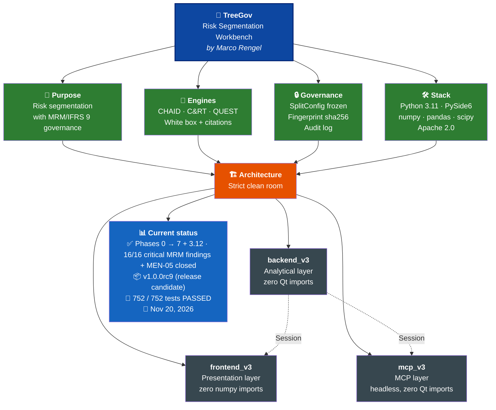

# TreeGov — Risk Segmentation Workbench

**Version**: 1.0.0rc9
**Author**: Marco Rengel
**License**: Apache 2.0
**Graphics engine**: PySide6
**Analytical engine**: Python (NumPy, pandas, scipy.stats)
**Test suite**: 752/752 passing

> ⚠️ **Regulatory notice.** TreeGov is under technical validation (Model Risk Management - MRM). **Restricted use: technical MRM validation. Not fit for banking production without regulatory approval.** Any use in a regulated production environment (banking or otherwise) requires independent validation, formal approval, and integration with the institution's model governance framework.

**Data scope.** TreeGov is developed exclusively with public *datasets* (German Credit, UCI) and synthetic data. It is designed for end use with real banking data on the analyst's desktop: the CSV never leaves the machine. No real data is sent to third-party AI APIs during development. When TreeGov is used in production with real data, the DEBUG *logs* and exported HTML *reports* contain sensitive model information (per-node PDs, segment counts, real column names, file paths) and should be treated as confidential material by the analyst.

---

## Executive summary

TreeGov is an open-source platform to build, validate, and audit decision-tree models in regulated environments. It is the successor to classic GUI tools (now discontinued) that allowed analysts to build models without programming. Unlike closed corporate suites, TreeGov democratizes model governance (MRM) and compliance with standards such as Basel and IFRS 9.

The system implements CHAID (classic and Exhaustive), C&RT, and QUEST with white-box mathematics: every statistical formula is written explicitly and cited to its original publication. Governance is opt-out through two explicit modes. Regulatory mode (the default) applies the full MRM layer required by banks and credit bureaus: Jeffreys estimator, PD floor (BCBS CRE 32.4), and fingerprints that record the choice. Research mode produces raw empirical probabilities, opening the tool to domains such as health, biology, or social sciences. The choice is always explicit and never silent.

Traditional libraries (*scikit-learn*, *statsmodels*, or R packages) require writing code, which takes time away from analysis. Meanwhile, the visual tools that existed in the past were discontinued. TreeGov fills that void by combining an *open-source* visual environment with regulatory traceability (SR 11-7, Basel, IFRS 9) as a core design principle.

---

## Philosophy

> “Python gives you the engine. TreeGov gives you the engine, the brakes, the dashboard, the seatbelt, and the maintenance log. Which would you choose for a model that will be audited by the regulator?”

TreeGov starts from one premise: model governance is not a layer you add at the end, but a principle woven into every component. While statistical libraries and *scripting* environments provide the analytical engine, TreeGov provides in addition the brakes (MRM controls), the dashboard (graphical display), the seatbelt (auditability), and the maintenance log (the immutable audit trail). For a model that will be audited by a regulator, the choice is not technical: it is about governance.

Beyond using MRM inside the tool, **the software itself is built under MRM discipline**: design audits before code, human-in-the-loop supervision, adversarial verification, and immutable traceability for every release.

TreeGov is a **clean-room development**: a modern mathematical reimplementation derived exclusively from academic papers (Kass, Breiman, Loh & Shih) and the documented classic tree-station standard (circa 2001). All of its logic is white-box, guaranteeing algorithmic independence and maximum auditability (`docs/design_decisions.md` §0.5).

*Read the full project philosophy → [English](https://github.com/Marco-Rengel/treegov/blob/main/docs/philosophy.md) · [Español](https://github.com/Marco-Rengel/treegov/blob/main/docs/philosophy.es.md)*



---

## What is TreeGov?

TreeGov is an analytical workbench to build, evaluate, and audit decision trees in regulated environments. Unlike *machine learning* libraries, where the analyst operates in a black box, TreeGov provides a visual environment with explicit mathematics and absolute traceability.

The core feature of TreeGov is radical auditability. Absolutely every stage of the model's lifecycle can be traced by an auditor:
*   The code: every statistical formula is written explicitly and cited to its original publication.
*   The decisions: the architecture and *trade-offs* are documented to justify every choice.
*   The model: every training run generates a unique *fingerprint* that acts as an immutable seal.
*   The evidence: a transactional log records every step, and a suite of over 750 tests (including validated public *datasets*) guarantees reproducibility.

---

## Design principles

1. **Bidirectional clean-room architecture**: strict separation between the analytical backend (`backend_v3/`, zero Qt/GUI dependencies) and the presentation layer (`frontend_v3/`, zero analytical logic), enforced by bidirectional AST guardrails (`test_frontend_clean_room` and `test_backend_clean_room`).
2. **Expanded white-box enforcement**: *sklearn*, *scikit-learn*, *statsmodels*, *xgboost*, *lightgbm*, *catboost*, *torch*, *optbinning*, *scorecardpy*, *tensorflow*, and *keras* are blocked at the interpreter level by `backend_v3/import_guard.py`, auto-installed across all entry points (`backend_v3`, `frontend_v3`, `mcp_v3`, `treegov.py`, `treegov_gui.py`, `treegov_mcp.py`, `scripts/validate_uci.py`). Every statistical formula is written explicitly in the code, with its bibliographic citation.
3. **Native governance**: DEBUG-grade transactional logging, immutable configuration (*SplitConfig frozen*), strict Basel III CRE 32.4 mode classification (`BANKING` / `RESEARCH` / `CUSTOM`), mandatory SR 11-7 validation (Holdout or k-fold CV), and mathematical invariant validation at construction time.

---

## Analytical capabilities

| Capability | Reference | Regulatory anchor | Key characteristics |
|---|---|---|---|
| **CHAID** classic and Exhaustive | Kass (1980); Biggs et al. (1991); Chan, Golub & LeVeque (1983) | — | Iterative category merging with Bonferroni correction, multiclass support, continuous binning via 10 quantile cuts (up to 11 bins, `(a, b]` with `right=True`), centered continuous variance, and Cochran-eligible selection in Exhaustive CHAID |
| **C&RT** | Breiman et al. (1984); Chan, Golub & LeVeque (1983) | — | Normalized overflow/cancellation-safe Gini impurity / centered variance reduction, surrogate splits, multiclass (K ≥ 2) |
| **QUEST** | Loh & Shih (1997); Kish (1965) | — | Unbiased variable selection, Kish reliability-weighted variance (scale-invariant and safe with normalized weights) and Citardauq stable quadratic roots for K=2 QDA, Gini sweep for K > 2 (hybrid C&RT/QUEST approach for multiclass) |
| **Multiclass Support** | Hand & Till (2001) | — | End-to-end K ≥ 3 support (including string targets), canonically translated gains table, multiclass Gini and pairwise KS, and dynamic K × K classification matrix in GUI and HTML |
| **Sample Weighting** | Heeringa et al. (2010) | SR 11-7 | Sample bias adjustment across engines, tree construction, validation metrics and stability monitoring. Known limitation: the train/test split stratifies by physical row count (not weighted mass) and surrogate agreement in C&RT is not weighted (design_decisions.md §13.3, §13.6.2). The binary gains table's global metrics ARE now weighted (D13 resolved 20/10/2026; see design_decisions.md §13.7). |
| **Population Categories** | — | — | *Opt-in* filter to exclude categories (Indet, No Perf) before training (tracked in `params_fingerprint`) |
| **Jeffreys estimator + PD Floor** | Jeffreys (1946) | BCBS CRE 32.4 | Mitigation of zero probabilities in low-default portfolios; strict `BANKING` classification requires `apply_jeffreys=True` and `pd_floor >= 0.0005` (`0.0` or legacy `0.0003` classify as `CUSTOM`) |
| **Hamilton-Hare partition** | — | — | Exact stratified train/test *split* (`Q_j = N_j * train_frac`), fail-fast `NaN` rejection, no rounding bias |
| **Anti-leakage imputation** | — | SR 11-7 | Train-only statistics (`TrainOnlyImputer`) with fail-fast `±inf` rejection |
| **Cost-complexity pruning** | Breiman et al. (1984) | — | Post-pruning with the α sequence; deterministic node re-indexing; active pruned model (`Session.active_tree`) connected across all downstream consumers and GUI `PruneDialog` with automatic invalidation of stale metrics |
| **Out-of-Sample (OOS) / Out-of-Time (OOT) validation** | Hanley & McNeil (1982); Hosmer & Lemeshow (1980); Hosmer, Lemeshow & Sturdivant (2013) | Basel; SR 11-7 | Gini, KS, tie-preserving row-order-invariant Hosmer-Lemeshow with external degrees of freedom `df = G_eff` (Hosmer, Lemeshow & Sturdivant 2013 §5.2.2) and `_HL_EPS = 1e-6`, Brier, ROC/AUC, PR-AUC, binary `w_accuracy`, and CV-compatible `evaluate_oot` |
| **Stability monitoring** | Siddiqi (2006) | Basel / EBA | Population Stability Index (PSI, leaves) and Characteristic Stability Index (CSI, covariates) with configurable/validated `eps`, `(a, b]` intervals (`right=True`), explicit `<MISSING>` bin for `NaN`, constant-continuous drift detection, and undefined `Gini Drop` (`UNDETERMINED`) when `Gini_train <= 0` |
| **UCI dataset validation** | UCI ML Repository | — | Reproducibility anchored to 6 *datasets* (German Credit, Breast Cancer, etc.) |

---

## Technology stack

- Python 3.11 / 3.12
- PySide6 (graphical interface)
- numpy, pandas, scipy.stats (statistical computation)
- pyarrow, openpyxl (data ingestion)
- pytest (optional: tests are runnable with plain python)

---

## Repository structure

```
TreeGov/
├── backend_v3/              # Pure analytical layer (0 Qt imports)
│   ├── import_guard.py      # Black-box library blocker
│   ├── log_config.py        # DEBUG transactional logger
│   ├── types.py             # SplitConfig (frozen) + enums
│   ├── statistics.py        # chi2, F, Brown-Forsythe, Stirling, Kass
│   ├── imputation.py        # TrainOnlyImputer (anti-leakage)
│   ├── chaid_engine.py      # CHAID classic + Exhaustive
│   ├── crt_engine.py        # C&RT multiclass + surrogate splits
│   ├── quest_engine.py      # QUEST multiclass + QDA/Gini
│   ├── splitting.py         # Hamilton-Hare stratified split
│   ├── profiling.py         # Predictor type inference
│   ├── tree_builder.py      # BFS tree construction + TreeModel
│   ├── session_state.py     # Flow state machine (EMPTY to TRAINED to OOT)
│   ├── validation.py        # OOS metrics + OOT evaluation
│   ├── pruning.py           # Cost-complexity pruning (Breiman)
│   ├── reporting.py         # Gains table + classification matrix DTOs
│   ├── stability.py         # PSI / CSI / Gini Drop
│   ├── exporters.py         # SQL / Python / Markdown production exporters (Phase 4.0)
│   ├── scoring.py           # Batch scoring + champion-challenger (Phase 6.0)
│   └── ecl.py               # IFRS 9 ECL: staging + PD × LGD × EAD (Phase 7.0)
├── frontend_v3/             # Presentation layer (Phase 2)
├── mcp_v3/                  # MCP layer, headless (dto, server, tools — Phase 5.0)
├── scripts/                 # Infrastructure and validation utilities (fetch, validate, update_readme)
├── tests/                   # Unit tests (dual: pytest / python direct)
├── docs/                    # Documentation and project governance
│   ├── api.md               # Public API surface (EN)
│   ├── design_decisions.md  # Implementation decisions (EN)
│   ├── methodology.md       # Mathematical methodology (EN)
│   ├── roadmap.md           # Phase plan and current status (EN)
│   ├── audit_log.md         # Chronological log of changes (ES)
│   ├── estado_proyecto.md   # Executive dossier of the project (ES)
│   ├── security_audit.md    # Security and privacy audit (EN)
│   ├── playbook.md          # Governance playbook and workflows (ES)
│   ├── 3.12_design_analysis_workspace.md # Latest phase design + as-built (ES)
│   ├── ( ... and 30+ design documents for phases 3.1 through 7.0, plus context files ... )
├── archive/                 # Historical documents (read-only)
├── data/                    # Datasets (read-only, Git-ignored)
├── logs/                    # Per-run execution logs (Git-ignored)
├── treegov.py               # Headless orchestrator (CLI)
├── treegov_gui.py           # GUI entry point (Phase 2)
├── treegov_mcp.py           # MCP server entry point (console script treegov-mcp, Phase 5.0)
├── pyproject.toml           # Packaging
├── requirements.txt         # Working minimum pins (pyproject.toml is source of truth)
├── opencode.json            # OpenCode project configuration
├── README.md                # This file (EN)
├── README.es.md             # Spanish translation
├── AGENTS.md                # Operating instructions for AI agents
├── CONVENTIONS.md           # Operational conventions for Aider
├── LICENSE                  # Apache 2.0
├── NOTICE.md                # Legal notice and attribution
├── .gitignore               # Git exclusions
├── .aiderignore             # Aider repo-map exclusions
├── .gitattributes           # Line-ending normalization
├── .aider.conf.example.yml  # Aider configuration template
└── .treegovrules            # Governance rules for AI agents
```

---

## Why TreeGov?

| If you need... | Use... |
|----------------|--------|
| Dozens or hundreds of ML algorithms | *scikit-learn* |
| *Deep Learning* | *PyTorch* or *TensorFlow* |
| *Gradient Boosting* | *XGBoost* or *LightGBM* |
| **Auditable trees with MRM governance** | **TreeGov** |

---

## Quick start

### Installation

```powershell
.\.venv\Scripts\python -m pip install -r requirements.txt
```

### Headless demo (Phase 0)

```powershell
.\.venv\Scripts\python treegov.py
```

### Performance benchmark (N=1M)

```powershell
.\.venv\Scripts\python tests\benchmark_1m.py --n 1000000 --seed 42
```

### Test suite

```powershell
.\.venv\Scripts\python -m pytest tests -q
```

---

## Project status

| Phase | Description | Status |
|---|---|---|
| **0** | Algorithmic core: 4 engines + statistics + imputation | Completed |
| **1** | Transactional flow: splitting, profiling, tree_builder, session_state | Completed |
| **1.2** | OOS evaluation + cost-complexity pruning | Completed |
| **1.3** | OOT validation + PSI/CSI stability monitoring | Completed |
| **2.0-2.2** | GUI with PySide6: skeleton, transactional wizard, tree viewer | Completed |
| **2.3** | OOS/OOT metrics panel | Completed |
| **2.4** | Reports + integration | Completed |
| **2.1.b** | Stratified k-fold cross-validation scheme + runtime import guardrail in the GUI layer (post-Phase 7 backlog B2a/B2b, closed 02/11/2026) | Completed |
| **3.0** | Documentation closure + configurable canonical parameters | Completed |
| **3.1** | Multiclass (target + wizard + MetricsPanel alerts) | Completed |
| **3.2** | Sample weighting | Completed |
| **3.3** | Indet / Insufficient / No Perf categories | Completed |
| **3.4** | Multiclass support in C&RT and QUEST | Completed |
| **3.5** | Reports adapted for multiclass and weighting | Completed |
| **3.6.a** | Design of public-dataset validation plan | Completed |
| **3.6.b** | Fetch script + versioned fixtures | Completed |
| **3.6.c** | Integration tests + validation report | Completed |
| **3.6.d** | Phase documentation closure | Completed |
| **3.6.e** | Non-banking mode: dynamic terminology via `tr_term` (BANKING labels bit-identical; RESEARCH neutral) | Completed |
| **3.7** | Phase 3 closure + v1.0.0rc1 | Completed |
| **3.7.e** | Pre-release fixes (H1, H2, pd_floor K=2) | Completed |
| **3.8** | Regulatory attribution correction (BCBS CRE 32.4) + v1.0.0rc2 | Completed |
| **3.9** | Interactive and Weighted Pruning | Completed |
| **3.10.a** | UX/UI Redesign: Toolbar, enriched tree nodes, right panel, dark theme hierarchy (H3-H8) | Completed |
| **3.10.b** | CHAID continuous alignment: automatic quantile binning (10 cuts, up to 11 bins), `bin_edges` in `SplitConfig`, `np.digitize` routing (H14) + visual hotfix (H9, H11-H13) | Completed |
| **3.11.a** | Base Redesign: Colab theme, Excel-style full-page tabs, resized Wizard, classic tree-station HTML nodes | Completed |
| **3.11.a.1** | Visual Hotfix: classic layout (8-menu bar, compact icon-only toolbar, 3-block left panel, bottom Excel-style tabs), QPainter audit-sheet nodes, forced dark/light theme via QPalette, numeric cut labels on edges, TSV clipboard copy in tables, GUI Design System | Completed |
| **3.11.b.1** | Data Viewer backend: `Session.get_data_preview` (raw CSV preview, native-type JSON-serializable dict, empty-dict idle state — §18.7) | Completed |
| **3.11.b.2** | Data Viewer frontend: `DataViewer` widget in the left panel, read-only table, truncation notice, Ctrl+C → TSV, live i18n | Completed |
| **3.11.b.3** | Tree Map: passive minimap in the left panel (independent scene, flat node rectangles, click → `centerOn` on the main view without touching zoom/selection, full rebuild on model change, exclusive `fitInView`, passive highlight of the current node) | Completed |
| **3.11.b.4** | Project Explorer: left-panel block with the current model's method + short fingerprint, reset to "—" on reconfigure | Completed |
| **3.11.b.5** | `NodeItem` Total row with `pct_global` (node n / root n): mandatory constructor parameter, label via `tr("tree_node_total")`, format `Total (<pct_global>) <n>` | Completed |
| **3.11.c.1** | Batch univariate trees backend: `Session.get_univariate_trees(max_depth=3)` — one tree per predictor with the same engine and governance, flat DTO (`predictor`, `gini`, `ks`, `cut_points`) | Completed |
| **3.11.c.2** | Univariate trees frontend: `UnivariateDialog` (Predictor \| Gini \| KS \| Cuts), Ctrl+C → TSV (Rule 4.1.1), CSV export, Analysis menu action enabled in TRAINED | Completed |
| **3.11.c.3** | Cost matrix N×N: immutable `SessionState.cost_matrix`, hardened `fix_spec(cost_matrix=...)`, "Costs" tab in the Advanced Options dialog; NOT in `params_fingerprint` yet (§18.8) | Completed |
| **3.11.d** | Context menu and interactivity: `Session.intervene_node` (manual prune branch), BFS reindex, immutable `manual_overrides` log, node context menu with BANKING confirmation, `ManualOverrideDialog` + HUD "View Audit Log" button (§18.9) | Completed |
| **3.11.e** | Tree Map rewrite from scratch (Clean Room): tidy top-down Reingold-Tilford layout, orthogonal 3-segment connectors, screen-constant `node_id` labels, 100% palette-driven colours, bidirectional navigation via `center_on_node`, empty state without branding | Completed |
| **3.12** | Model inspection: Rules and Summary tabs, node/partition Data Viewer, three native gains charts; `Session.get_rules`, `get_summary` and `get_node_cases` | Completed |
| **4.0** | Export to production (SQL/Python/Markdown + GUI integration) | Completed |
| **4.0.1** | Exporters: categorical unseen_policy | Completed |
| **5** | MCP layer for LLM agents | Completed |
| **6** | Batch scoring + champion-challenger | Completed |
| **7** | IFRS 9 / ECL (staging, ECL = PD × LGD × EAD) | Completed |
| **Repo Hygiene (Phase 1)** | Workspace cleanup from 3.49 GB → ~6 MB (external clean venv), hardened `.gitignore`/`.aiderignore`, untracking of `archive/legacy_docs/`, path sanitization in `AGENTS.md` | Completed |
| **MRM Audit Remediation (`2A`–`2I`, `v1.0.0rc9`)** | 16/16 critical audit findings (`CRIT-01`–`CRIT-16`) + `MEN-05` bibliographic parity closed (24 academic + 4 regulatory references, zero attribution gray zones): exporter parity & majority leaf, strict Basel III governance, active pruning (`active_tree`), IFRS 9 staged ECL/EIR, `TREEGOV_MCP_ROOT` MCP security, end-to-end multiclass K ≥ 3 & hardened Wizard, engine numerical stability, OOS Hosmer-Lemeshow & PSI/CSI, SR 11-7 methodology alignment, and bidirectional Clean-Room/White-Box guardrails | Completed |

**Test suite: 752/752 passing.**

---

## Academic references

- Biggs, D., de Ville, B. & Suen, E. (1991). *A Method of Choosing Multiway Partitions for Classification and Decision Trees*. Journal of Applied Statistics 18(1), 49-62.
- Breiman, L., Friedman, J.H., Olshen, R.A. & Stone, C.J. (1984). *Classification and Regression Trees*. Wadsworth.
- Brier, G.W. (1950). *Verification of forecasts expressed in terms of probability*. Monthly Weather Review 78(1), 1-3.
- Brown, M.B. & Forsythe, A.B. (1974). *Robust Tests for the Equality of Variances*. Journal of the American Statistical Association 69(346), 364-367.
- Chan, T.F., Golub, G.H. & LeVeque, R.J. (1983). *Algorithms for Computing the Sample Variance: Analysis and Recommendations*. The American Statistician 37(3), 242-247.
- Cochran, W.G. (1954). *Some Methods for Strengthening the Common Chi-2 Tests*. Biometrics 10(4), 417-451.
- Davis, J. & Goadrich, M. (2006). *The relationship between Precision-Recall and ROC curves*. Proceedings of the 23rd International Conference on Machine Learning (ICML), 233-240.
- Fagerland, M.W., Hosmer, D.W. & Bofin, A.M. (2012). *Multinomial goodness-of-fit tests for logistic regression models*. Statistics in Medicine, 31(30), 4238-4253.
- Fisher, R.A. (1925). *Statistical Methods for Research Workers*. Oliver & Boyd, Edinburgh.
- Hand, D.J. & Till, R.J. (2001). *A simple generalisation of the area under the ROC curve for multiple class classification problems*. Machine Learning, 45(2), 171-186.
- Hanley, J.A. & McNeil, B.J. (1982). *The meaning and use of the area under a receiver operating characteristic (ROC) curve*. Radiology 143(1), 29-36.
- Heeringa, S.G., West, B.T. & Berglund, P.A. (2010). *Applied Survey Data Analysis*. Chapman & Hall/CRC.
- Hosmer, D.W. & Lemeshow, S. (1980). *A goodness-of-fit test for the multiple logistic regression model*. Communications in Statistics A10, 1043-1069.
- Hosmer, D.W., Lemeshow, S. & Sturdivant, R.X. (2013). *Applied Logistic Regression* (3rd ed.). Wiley.
- Jeffreys, H. (1946). *An invariant form for the prior probability in estimation problems*. Proceedings of the Royal Society of London A 186(1007), 453-461.
- Kass, G.V. (1980). *An Exploratory Technique for Investigating Large Quantities of Categorical Data*. Applied Statistics 29(2), 119-127.
- Kish, L. (1965). *Survey Sampling*. Wiley.
- Kohavi, R. (1995). *A study of cross-validation and bootstrap for accuracy estimation and model selection*. Proceedings of the 14th International Joint Conference on Artificial Intelligence (IJCAI), 1137-1143.
- Levene, H. (1960). *Robust tests for equality of variances*. In *Contributions to Probability and Statistics*, Stanford University Press, 278-292.
- Loh, W.-Y. & Shih, Y.-S. (1997). *Split Selection Methods for Classification Trees*. Statistica Sinica 7(4), 815-840.
- Massey, F.J. (1951). *The Kolmogorov-Smirnov Test for Goodness of Fit*. Journal of the American Statistical Association 46(253), 68-78.
- Pearson, K. (1900). *On the criterion that a given system of deviations from the probable in the case of a correlated system of variables is such that it can be reasonably supposed to have arisen from random sampling*. Philosophical Magazine Ser. 5, 50(302), 157-175.
- Press, W.H., Teukolsky, S.A., Vetterling, W.T. & Flannery, B.P. (2007). *Numerical Recipes: The Art of Scientific Computing* (3rd ed.), §5.6. Cambridge University Press.
- Siddiqi, N. (2006). *Credit Risk Scorecards: Developing and Implementing Intelligent Credit Scoring*. Wiley.

---

## Regulatory references

- **Basel (BCBS CRE 32.4)**: regulatory PD floors (0.05% for
  corporate, bank and retail; 0.03% or exempt for sovereign).
- **EBA/GL/2017/16**: guidelines on the specification, estimation, and validation of PD/LGD parameters in IRB models.
- **IFRS 9**: Phase 7 (hardened in Block 2C) implements a simplified, single-period, single-scenario ECL engine (`PD × LGD × EAD`) with deterministic staging, UI `% -> decimal` EIR conversion, non-negative `eir >= 0`, mandatory `PD = 1.0` in Stage 3 (credit-impaired/default), and combined staged provision (`total_ecl_staged` / `ecl_applicable`) across backend, GUI and MCP (`docs/7.0_design_ifrs9.md` §5–§6; `docs/design_decisions.md` §29). It does not certify full IFRS 9 compliance; multi-period curves, macroeconomic scenarios and asymmetric threshold optimization remain outside its scope.
- **SR 11-7 / OCC 2011-12**: model risk management (MRM) guidance.

---

### MCP Layer (Phase 5.0, hardened in Block 2C)
TreeGov exposes its analytical backend to LLM agents through the Model
Context Protocol (MCP) standard. The layer is headless (no GUI imports)
and exposes 27 tools over the same `Session` contract used by the GUI,
with strict `.csv` path confinement inside `TREEGOV_MCP_ROOT` (defaults
to `CWD`), anti-overwrite and `output_path == csv_path` blocking in
`score_batch`, fail-fast parameter/governance validation, and
`threading.RLock` serialization across all 27 tools.
Install: `pip install treegov[mcp]`
Usage: `treegov-mcp` (starts the stdio server).

## License

Apache License 2.0 — see [LICENSE](https://github.com/Marco-Rengel/treegov/blob/main/LICENSE).

---

## Contact

Marco Rengel — marcrengel@gmail.com — github.com/Marco-Rengel

---

## Translations

- [Español (Spanish)](README.es.md)
