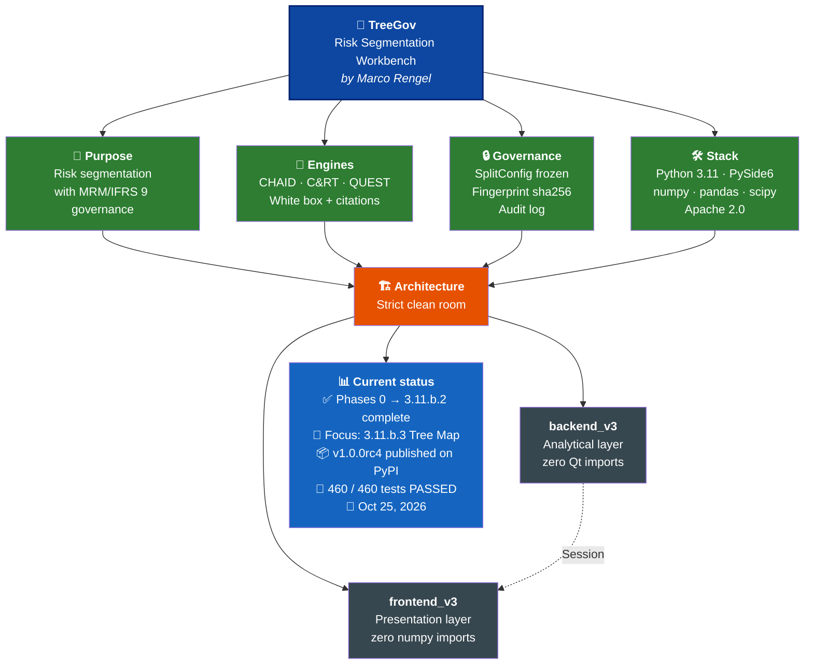

# TreeGov — Risk Segmentation Workbench

**Version**: 1.0.0rc4
**Author**: Marco Rengel
**License**: Apache 2.0
**Graphics engine**: PySide6
**Analytical engine**: Python (NumPy, pandas, scipy.stats)
**Test suite**: 449/449 passing

> ⚠️ **Regulatory notice.** TreeGov is under technical validation (Model Risk Management - MRM). **Restricted use: technical MRM validation. Not fit for banking production without regulatory approval.** Any use in a regulated production environment (banking or otherwise) requires independent validation, formal approval, and integration with the institution's model governance framework.

**Data scope.** TreeGov is developed exclusively with public *datasets* (German Credit, UCI) and synthetic data. It is designed for end use with real banking data on the analyst's desktop: the CSV never leaves the machine. No real data is sent to third-party AI APIs during development. When TreeGov is used in production with real data, the DEBUG *logs* and exported HTML *reports* contain sensitive model information (per-node PDs, segment counts, real column names, file paths) and should be treated as confidential material by the analyst.

---

## Executive summary

TreeGov is an open-source platform to build, validate, and audit decision-tree models in regulated environments. It is the successor to classic GUI tools (now discontinued) that allowed analysts to build models without programming. Unlike closed corporate suites, TreeGov democratizes model governance (MRM) and compliance with standards such as Basel and IFRS 9.

The system implements CHAID (classic and Exhaustive), C&RT, and QUEST with white-box mathematics: every statistical formula is written explicitly and cited to its original publication. Governance is opt-out through two explicit modes. Regulatory mode (the default) applies the full MRM layer required by banks and credit bureaus: Jeffreys estimator, PD floor (BCBS CRE 32.4), and fingerprints that record the choice. Research mode produces raw empirical probabilities, opening the tool to domains such as health, biology, or social sciences. The choice is always explicit and never silent.

Traditional libraries (*scikit-learn*, *statsmodels*, or R packages) require writing code, which takes time away from analysis. Meanwhile, the visual tools that existed in the past were discontinued. TreeGov fills that void by combining an *open-source* visual environment with regulatory traceability (SR 11-7, Basel, IFRS 9) as a core design principle.

---

## Philosophy

> “Python gives you the engine. TreeGov gives you the engine, the brakes, the dashboard, the seatbelt, and the maintenance log. Which would you choose for a model that will be audited by the regulator?”

TreeGov starts from one premise: model governance is not a layer you add at the end, but a principle woven into every component. While statistical libraries and *scripting* environments provide the analytical engine, TreeGov provides in addition the brakes (MRM controls), the dashboard (graphical display), the seatbelt (auditability), and the maintenance log (the immutable audit trail). For a model that will be audited by a regulator, the choice is not technical: it is about governance.

Beyond using MRM inside the tool, **the software itself is built under MRM discipline**: design audits before code, human-in-the-loop supervision, adversarial verification, and immutable traceability for every release.

TreeGov is a **clean-room development**: a modern mathematical reimplementation derived exclusively from academic papers (Kass, Breiman, Loh & Shih) and the documented classic tree-station standard (circa 2001). All of its logic is white-box, guaranteeing algorithmic independence and maximum auditability (`docs/design_decisions.md` §0.5).

*Read the full project philosophy → [English](https://github.com/Marco-Rengel/treegov/blob/main/docs/philosophy.md) · [Español](https://github.com/Marco-Rengel/treegov/blob/main/docs/philosophy.es.md)*



---

## What is TreeGov?

TreeGov is an analytical workbench to build, evaluate, and audit decision trees in regulated environments. Unlike *machine learning* libraries, where the analyst operates in a black box, TreeGov provides a visual environment with explicit mathematics and absolute traceability.

The core feature of TreeGov is radical auditability. Absolutely every stage of the model's lifecycle can be traced by an auditor:
*   The code: every statistical formula is written explicitly and cited to its original publication.
*   The decisions: the architecture and *trade-offs* are documented to justify every choice.
*   The model: every training run generates a unique *fingerprint* that acts as an immutable seal.
*   The evidence: a transactional log records every step, and a suite of over 400 tests (including validated public *datasets*) guarantees reproducibility.

---

## Design principles

1. **Clean-room architecture**: strict separation between the analytical backend (`backend_v3/`, no GUI dependencies) and the presentation layer (`frontend_v3/`, no analytical logic).
2. **White box**: *sklearn*, *statsmodels*, and any other black-box library are forbidden. Every statistical formula is written explicitly in the code, with its bibliographic citation.
3. **Native governance**: DEBUG-grade transactional logging, immutable configuration (*SplitConfig frozen*), and mathematical invariant validation at construction time.

---

## Analytical capabilities

| Capability | Reference | Regulatory anchor | Key characteristics |
|---|---|---|---|
| **CHAID** classic and Exhaustive | Kass (1980); Biggs et al. (1991) | — | Iterative category merging with Bonferroni correction, multiclass support, Cochran rule |
| **C&RT** | Breiman et al. (1984) | — | Gini impurity / variance reduction, surrogate splits, multiclass (K ≥ 2) |
| **QUEST** | Loh & Shih (1997) | — | Unbiased variable selection, QDA split for K=2, Gini sweep for K > 2 (hybrid C&RT/QUEST approach for multiclass) |
| **Multiclass Support** | Hand & Till (2001) | — | Training and metrics for K ≥ 2 classes; multiclass Gini and pairwise KS |
| **Sample Weighting** | Heeringa et al. (2010) | SR 11-7 | Sample bias adjustment across engines, tree construction, validation metrics and stability monitoring. Known limitation: the train/test split stratifies by physical row count (not weighted mass) and surrogate agreement in C&RT is not weighted (design_decisions.md §13.3, §13.6.2). The binary gains table's global metrics ARE now weighted (D13 resolved 20/10/2026; see design_decisions.md §13.7). |
| **Population Categories** | — | — | *Opt-in* filter to exclude categories (Indet, No Perf) before training |
| **Jeffreys estimator + PD Floor** | Jeffreys (1946) | BCBS CRE 32.4 | Mitigation of zero probabilities in low-default portfolios |
| **Hamilton-Hare partition** | — | — | Exact stratified train/test *split*, no rounding bias |
| **Anti-leakage imputation** | — | SR 11-7 | Train-only statistics (`TrainOnlyImputer`) |
| **Cost-complexity pruning** | Breiman et al. (1984) | — | Post-pruning with the α sequence; deterministic node re-indexing. Interactive and weighted (Phase 3.9): weighted error `r_w(t)` when the tree carries sample weights, exposed via `Session.get_prune_sequence()` and the GUI `PruneDialog`. |
| **Out-of-Sample (OOS) / Out-of-Time (OOT) validation** | Hanley & McNeil (1982); Hosmer & Lemeshow (1980) | Basel; SR 11-7 | Gini, KS, HL, Brier, ROC/AUC, PR-AUC; *out-of-time* cohort support |
| **Stability monitoring** | Siddiqi (2006) | Basel / EBA | Population Stability Index (PSI, leaves), Characteristic Stability Index (CSI, covariates), Gini Drop with traffic lights |
| **UCI dataset validation** | UCI ML Repository | — | Reproducibility anchored to 6 *datasets* (German Credit, Breast Cancer, etc.) |

---

## Technology stack

- Python 3.11 / 3.12
- PySide6 (graphical interface)
- numpy, pandas, scipy.stats (statistical computation)
- pyarrow, openpyxl (data ingestion)
- pytest (optional: tests are runnable with plain python)

---

## Repository structure

```
TreeGov/
├── backend_v3/              # Pure analytical layer (0 Qt imports)
│   ├── import_guard.py      # Black-box library blocker
│   ├── log_config.py        # DEBUG transactional logger
│   ├── types.py             # SplitConfig (frozen) + enums
│   ├── statistics.py        # chi2, F, Brown-Forsythe, Stirling, Kass
│   ├── imputation.py        # TrainOnlyImputer (anti-leakage)
│   ├── chaid_engine.py      # CHAID classic + Exhaustive
│   ├── crt_engine.py        # C&RT multiclass + surrogate splits
│   ├── quest_engine.py      # QUEST multiclass + QDA/Gini
│   ├── splitting.py         # Hamilton-Hare stratified split
│   ├── profiling.py         # Predictor type inference
│   ├── tree_builder.py      # BFS tree construction + TreeModel
│   ├── session_state.py     # Flow state machine (EMPTY to TRAINED to OOT)
│   ├── validation.py        # OOS metrics + OOT evaluation
│   ├── pruning.py           # Cost-complexity pruning (Breiman)
│   ├── reporting.py         # Gains table + classification matrix DTOs
│   └── stability.py         # PSI / CSI / Gini Drop
├── frontend_v3/             # Presentation layer (Phase 2)
├── tests/                   # Unit tests (dual: pytest / python direct)
├── docs/                    # Documentation
│   ├── methodology.md       # Mathematical methodology (EN)
│   ├── design_decisions.md  # Implementation decisions (EN)
│   ├── 3.1_design_multiclass.md  # Phase 3.1 design (EN)
│   ├── 3.2_decisions_consolidated.md  # Phase 3.2 decisions (EN)
│   ├── 3.3_design_population_categories.md  # Phase 3.3 design (EN)
│   ├── 3.4_design_multiclass_crt_quest.md  # Phase 3.4 design (EN)
│   ├── 3.5_design_multiclass_weighted_reports.md  # Phase 3.5 design (EN)
│   ├── 3.6_design_public_datasets.md  # Phase 3.6 design (EN)
│   ├── 3.7_design_pre_release_fixes.md  # Phase 3.7 design (EN)
│   ├── 3.8_design_regulatory_attribution.md  # Phase 3.8 design (EN)
│   ├── 3.9_design_interactive_weighted_pruning.md  # Phase 3.9 design (EN)
│   ├── 3.10.a_design_ux_ui_redesign.md  # Phase 3.10.a design + as-built (EN)
│   ├── 3.10.b_design_chaid_binning.md  # Phase 3.10.b design + as-built (EN)
│   ├── 3.11_design_interactive_tree.md  # Phase 3.11 design (EN)
│   ├── 3.11.a_design_colab_theme.md  # Phase 3.11.a as-built (EN)
│   ├── 3.11_classic_tree_ui_reference.md  # Classic tree-station visual reference, circa 2001 (ES)
│   ├── validation_results_3.6.md  # UCI validation report (EN)
│   ├── security_audit.md      # Security and privacy audit (EN)
│   ├── playbook.md          # Governance playbook (EN)
│   ├── api.md               # Public API (EN)
│   ├── roadmap.md           # Phase plan (EN)
│   ├── philosophy.md        # Project philosophy (EN)
│   ├── philosophy.es.md     # Philosophy (ES)
│   ├── estado_proyecto.md   # Project state dossier (ES)
│   ├── audit_log.md         # Audit trail (ES)
│   ├── contexto_para_nueva_sesion.md  # Session bootstrap (ES)
│   └── prompt_para_asistente.md       # Assistant brief (ES)
├── archive/                 # Historical documents (read-only)
├── data/                    # Datasets (read-only, Git-ignored)
├── logs/                    # Per-run execution logs (Git-ignored)
├── treegov.py               # Headless orchestrator (CLI)
├── treegov_gui.py           # GUI entry point (Phase 2)
├── pyproject.toml           # Packaging
├── requirements.txt         # Working minimum pins (pyproject.toml is source of truth)
├── opencode.json            # OpenCode project configuration
├── README.md                # This file (EN)
├── README.es.md             # Spanish translation
├── AGENTS.md                # Operating instructions for AI agents
├── CONVENTIONS.md           # Operational conventions for Aider
├── LICENSE                  # Apache 2.0
├── NOTICE.md                # Legal notice and attribution
├── .gitignore               # Git exclusions
├── .aiderignore             # Aider repo-map exclusions
├── .gitattributes           # Line-ending normalization
├── .aider.conf.example.yml  # Aider configuration template
└── .treegovrules            # Governance rules for AI agents
```

---

## Why TreeGov?

| If you need... | Use... |
|----------------|--------|
| Dozens or hundreds of ML algorithms | *scikit-learn* |
| *Deep Learning* | *PyTorch* or *TensorFlow* |
| *Gradient Boosting* | *XGBoost* or *LightGBM* |
| **Auditable trees with MRM governance** | **TreeGov** |

---

## Quick start

### Installation

```powershell
.\.venv\Scripts\python -m pip install -r requirements.txt
```

### Headless demo (Phase 0)

```powershell
.\.venv\Scripts\python treegov.py
```

### Performance benchmark (N=1M)

```powershell
.\.venv\Scripts\python tests\benchmark_1m.py --n 1000000 --seed 42
```

### Test suite

```powershell
.\.venv\Scripts\python -m pytest tests -q
```

---

## Project status

| Phase | Description | Status |
|---|---|---|
| **0** | Algorithmic core: 4 engines + statistics + imputation | Completed |
| **1** | Transactional flow: splitting, profiling, tree_builder, session_state | Completed |
| **1.2** | OOS evaluation + cost-complexity pruning | Completed |
| **1.3** | OOT validation + PSI/CSI stability monitoring | Completed |
| **2.0-2.2** | GUI with PySide6: skeleton, transactional wizard, tree viewer | Completed |
| **2.3** | OOS/OOT metrics panel | Completed |
| **2.4** | Reports + integration | Completed |
| **3.0** | Documentation closure + configurable canonical parameters | Completed |
| **3.1** | Multiclass (target + wizard + MetricsPanel alerts) | Completed |
| **3.2** | Sample weighting | Completed |
| **3.3** | Indet / Insufficient / No Perf categories | Completed |
| **3.4** | Multiclass support in C&RT and QUEST | Completed |
| **3.5** | Reports adapted for multiclass and weighting | Completed |
| **3.6.a** | Design of public-dataset validation plan | Completed |
| **3.6.b** | Fetch script + versioned fixtures | Completed |
| **3.6.c** | Integration tests + validation report | Completed |
| **3.6.d** | Phase documentation closure | Completed |
| **3.6.e** | Non-banking mode and extensive multi-domain validation | Planned for 1.1.0 |
| **3.7** | Phase 3 closure + v1.0.0rc1 | Completed |
| **3.7.e** | Pre-release fixes (H1, H2, pd_floor K=2) | Completed |
| **3.8** | Regulatory attribution correction (BCBS CRE 32.4) + v1.0.0rc2 | Completed |
| **3.9** | Interactive and Weighted Pruning | Completed |
| **3.10.a** | UX/UI Redesign: Toolbar, enriched tree nodes, right panel, dark theme hierarchy (H3-H8) | Completed |
| **3.10.b** | CHAID continuous alignment: automatic decile binning, `bin_edges` in `SplitConfig`, `np.digitize` routing (H14) + visual hotfix (H9, H11-H13) | Completed |
| **3.11.a** | Base Redesign: Colab theme, Excel-style full-page tabs, resized Wizard, classic tree-station HTML nodes | Completed |
| **3.11.a.1** | Visual Hotfix: classic layout (8-menu bar, compact icon-only toolbar, 3-block left panel, bottom Excel-style tabs), QPainter audit-sheet nodes, forced dark/light theme via QPalette, numeric cut labels on edges, TSV clipboard copy in tables, GUI Design System | Completed |
| **3.11.b.1** | Data Viewer backend: `Session.get_data_preview` (raw CSV preview, native-type JSON-serializable dict, empty-dict idle state — §18.7) | Completed |
| **3.11.b.2** | Data Viewer frontend: `DataViewer` widget in the left panel, read-only table, truncation notice, Ctrl+C → TSV, live i18n | Completed |
| **4** | Advanced reports + export (SQL, Python, MD/JSON) | Planned |
| **5** | MCP layer for LLM agents | Planned |
| **6** | Batch scoring + champion-challenger | Planned |
| **7** | IFRS 9 / ECL (staging, ECL = PD x LGD x EAD) | Planned |

**Test suite: 460/460 passing.**

---

## Academic references

- Biggs, D., de Ville, B. & Suen, E. (1991). *A Method of Choosing Multiway Partitions for Classification and Decision Trees*. Journal of Applied Statistics 18(1), 49-62.
- Breiman, L., Friedman, J.H., Olshen, R.A. & Stone, C.J. (1984). *Classification and Regression Trees*. Wadsworth.
- Brier, G.W. (1950). *Verification of forecasts expressed in terms of probability*. Monthly Weather Review 78(1), 1-3.
- Brown, M.B. & Forsythe, A.B. (1974). *Robust Tests for the Equality of Variances*. Journal of the American Statistical Association 69(346), 364-367.
- Cochran, W.G. (1954). *Some Methods for Strengthening the Common Chi-2 Tests*. Biometrics 10(4), 417-451.
- Davis, J. & Goadrich, M. (2006). *The relationship between Precision-Recall and ROC curves*. Proceedings of the 23rd International Conference on Machine Learning (ICML), 233-240.
- Fagerland, M.W., Hosmer, D.W. & Bofin, A.M. (2012). *Multinomial goodness-of-fit tests for logistic regression models*. Statistics in Medicine, 31(30), 4238-4253.
- Fisher, R.A. (1925). *Statistical Methods for Research Workers*. Oliver & Boyd, Edinburgh.
- Hanley, J.A. & McNeil, B.J. (1982). *The meaning and use of the area under a receiver operating characteristic (ROC) curve*. Radiology 143(1), 29-36.
- Hand, D.J. & Till, R.J. (2001). *A simple generalisation of the area under the ROC curve for multiple class classification problems*. Machine Learning, 45(2), 171-186.
- Heeringa, S.G., West, B.T. & Berglund, P.A. (2010). *Applied Survey Data Analysis*. Chapman & Hall/CRC.
- Hosmer, D.W. & Lemeshow, S. (1980). *A goodness-of-fit test for the multiple logistic regression model*. Communications in Statistics A10, 1043-1069.
- Jeffreys, H. (1946). *An invariant form for the prior probability in estimation problems*. Proceedings of the Royal Society of London A 186(1007), 453-461.
- Kass, G.V. (1980). *An Exploratory Technique for Investigating Large Quantities of Categorical Data*. Applied Statistics 29(2), 119-127.
- Levene, H. (1960). *Robust tests for equality of variances*. In Contributions to Probability and Statistics, Stanford University Press, 278-292.
- Loh, W.-Y. & Shih, Y.-S. (1997). *Split Selection Methods for Classification Trees*. Statistica Sinica 7(4), 815-840.
- Pearson, K. (1900). *On the criterion that a given system of deviations from the probable in the case of a correlated system of variables is such that it can be reasonably supposed to have arisen from random sampling*. Philosophical Magazine Ser. 5, 50(302), 157-175.
- Siddiqi, N. (2006). *Credit Risk Scorecards: Developing and Implementing Intelligent Credit Scoring*. Wiley.

---

## Regulatory references

- **Basel (BCBS CRE 32.4)**: regulatory PD floors (0.05% for
  corporate, bank and retail; 0.03% or exempt for sovereign).
- **EBA/GL/2017/16**: guidelines on the specification, estimation, and validation of PD/LGD parameters in IRB models.
- **IFRS 9**: the mathematical framework for staging, ECL and asymmetric threshold optimization is documented in `docs/methodology.md` §8.6, but the executable implementation of ECL = PD × LGD × EAD, staging, and asymmetric threshold optimization is planned for Phase 7 and is **not implemented** in 1.0.0rc4.
- **SR 11-7 / OCC 2011-12**: model risk management (MRM) guidance.

---

## License

Apache License 2.0 — see [LICENSE](https://github.com/Marco-Rengel/treegov/blob/main/LICENSE).

---

## Contact

Marco Rengel — marcrengel@gmail.com — github.com/Marco-Rengel

---

## Translations

- [Español (Spanish)](README.es.md)