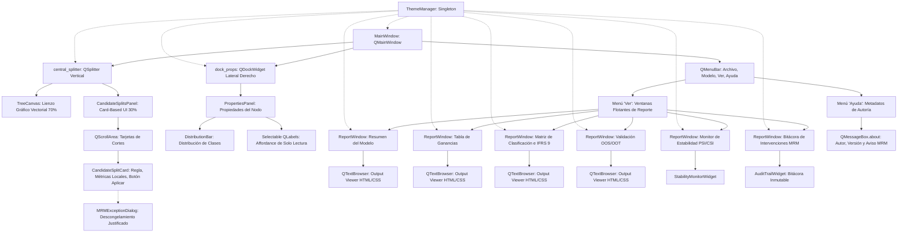

> **[DOCUMENTO HISTÓRICO — era pre-TreeGov]** 
> Este documento fue parte del proyecto DecisionTree_Modeler (fases previas 
> a la reconstrucción de TreeGov, septiembre 2026). Se conserva como 
> evidencia de auditoría. No forma parte de la documentación vigente.
> Para la documentación actual, ver docs/methodology.md y docs/audit_log.md.

# Bitácora de Arquitectura de Interfaz Gráfica y Estado de UX/UI
## Plataforma Analítica DecisionTree_Modeler

**Versión de UI**: 0.9.0-beta (Sprint 3 / Workspace-Centric & Output Viewer)  
**Framework de Presentación**: PySide6 (Qt for Python) `>= 6.5.0`  
**Paradigma Visual**: Workspace-Centric (Lienzo Central) + Visores de Resultados Estadísticos (*Output Viewer*)  
**Estado General de la GUI**: **100% Consolidada, Certificada y Operativa**

---

## 1. Mapeo Integral de Clases y Jerarquía de Presentación

La interfaz gráfica sigue el principio estricto de **Presentación Pasiva** y diseño de grado econométrico: el motor analítico (`backend/`) se mantiene completamente desacoplado de la GUI, mientras que la ventana principal actúa como un espacio de trabajo unificado (*Workbench*).



---

## 2. Principales Hitos Arquitectónicos (Sprint 3)

### 2.1. Paradigma "Lienzo Central" (Workspace-Centric)
* **Desmantelamiento de `QTabWidget` Central**:
  Se eliminó la saturación de pestañas que fragmentaba el flujo analítico. El lienzo del árbol (`TreeCanvas`) retoma el protagonismo visual absoluto como el núcleo de interacción del modelador.
* **Integración del `QSplitter` Vertical**:
  El área central de la aplicación (`self.central_splitter = QSplitter(Qt.Orientation.Vertical)`) distribuye el espacio de trabajo en:
  * **Zona Superior (70%)**: `TreeCanvas`, lienzo gráfico con zoom dinámico (`QGraphicsView` interactivo), badges de estadísticas de nodo, distribución y enlaces jerárquicos.
  * **Zona Inferior (30%)**: `CandidateSplitsPanel`, panel interactivo de partición asistida que expone en tiempo real las alternativas de corte para el nodo seleccionado.
* **Persistencia y Ergonomía**:
  El divisor permite colapsar o expandir el panel de candidatos con facilidad, manteniendo el lienzo del árbol siempre visible.

---

### 2.2. Panel de Cortes Candidatos (Card-Based UI)
* **Abandono de `QTableWidget` en Candidatos**:
  Se sustituyó la grilla tabular rígida por una interfaz moderna orientada a tarjetas (*Card-based UI*) encapsulada en un `QScrollArea` con política de redimensionamiento dinámico (`setWidgetResizable(True)`).
* **Anatomía de la Tarjeta (`CandidateSplitCard`)**:
  Cada tarjeta (`QFrame`) cuenta con bordes sutiles, esquinas redondeadas y tres bloques funcionales:
  1. **Bloque Izquierdo (Regla y Variable)**:
     - Nombre de la variable predictora en tipografía destacada (negrita).
     - Expresión formal del corte (ej. `ingreso <= 1500.00` vs `ingreso > 1500.00`).
     - Badge distintivo de tipo de dato: `[Numérica]` o `[Categórica]`.
  2. **Bloque Central (Métricas de Impacto)**:
     - Cuadrícula compacta de métricas analíticas:
       * **KS Local**: Separación discriminante entre ramas hijas.
       * **$\Delta$Gini**: Ganancia neta de impureza.
       * **WoE e IV**: Poder predictivo e Information Value.
       * **Odds Ratio**: Razón de momios relativa.
       * **$p$-valor $\chi^2$**: Significancia estadística de la asociación.
  3. **Bloque Derecho (Acción)**:
     - Botón interactivo `⚡ Aplicar Corte` conectado a la señal `split_selected`.
* **Gobernanza de Nodos Congelados (*Frozen Node Protection*)**:
  Si el nodo activo está congelado por requerimientos de Model Risk Management (`is_frozen = True`), el intento de aplicar un corte despliega el cuadro modal `MRMExceptionDialog`, exigiendo la justificación técnica obligatoria del modelador antes de asentar el cambio en la bitácora inmutable (`AuditTrail`).

---

### 2.3. Paradigma "Visor de Resultados Estadísticos" (Output Viewer)
* **Desmantelamiento de `QTableWidget` y `QTreeWidget` en Reportes**:
  Se erradicó el anti-patrón visual estilo Business Intelligence (BI), caracterizado por celdas desproporcionadas, espacios en blanco excesivos y bloqueo de selección nativa.
* **Adopción de `QTextBrowser`**:
  Los módulos de reporte (`ModelSummaryWidget`, `GainsTableWidget`, `ClassificationMatrixWidget`, `ValidationPanelWidget`) migraron a un contenedor único `QTextBrowser`:
  * Selección libre de texto y copia directa al portapapeles (`setTextInteractionFlags(Qt.TextBrowserInteraction)`).
  * Renderizado mediante plantillas HTML/CSS minimalistas estandarizadas con tipografía monoespaciada/sans-serif de alta densidad y alineación numérica a la derecha.
  * Soporte de exportación directa a formatos planos y método `get_html()` para inspección y certificación automatizada.
* **Ventanas Flotantes Independientes (`ReportWindow`)**:
  Los reportes se despliegan en ventanas independientes no modales (`QMainWindow`), emulando la operatividad de paquetes estadísticos profesionales (SPSS AnswerTree / Stata). Se gestionan a través del menú superior `Ver`, asegurando que no se dupliquen instancias en memoria.

---

### 2.4. Menú de Ayuda y Metadatos de Autoría
* **Menú `Ayuda` en `QMenuBar`**:
  Incorporación de la opción `Acerca de...` (`act_about`) con diálogo modal `QMessageBox.about`.
* **Estructura de Metadatos Institucionales**:
  * **Nombre**: Decision Tree Modeler - Risk Segmentation Workbench
  * **Versión**: 0.9.0-beta (Versión Preliminar)
  * **Autor**: Marco Antonio Rengel Calvopiña
  * **Motor Gráfico**: PySide6 (Qt for Python)
  * **Motor Analítico**: Python (SciPy, Pandas, NumPy)
  * **Aviso**: Software en fase de validación técnica (MRM).

---

## 3. Estado Detallado por Módulo del Frontend

| Componente | Archivo | Tipo de Contenedor | Rol en el Workbench |
|---|---|---|---|
| **Lienzo Principal** | `tree_canvas.py` | `QGraphicsView` | Renderizado vectorial de la estructura del árbol y nodos. |
| **Panel de Candidatos** | `candidate_splits_panel.py` | `QScrollArea` + Cards | Partición asistida multivariada Top-2 con métricas locales. |
| **Propiedades del Nodo** | `properties_panel.py` | `QDockWidget` (`QScrollArea`) | HUD Compacto: 6 métricas exclusivas (ID, N, Bad, Bad Rate, Gini, KS) y acciones. |
| **Resumen del Modelo** | `model_summary.py` | `QTextBrowser` | Visor estadístico de especificaciones, topología y KPIs sin tablas. |
| **Tabla de Ganancias** | `gains_table.py` | `QTextBrowser` | Visor estadístico con ordenamiento descendente por Bad Rate (%), eventos y lift. |
| **Matriz de Clasificación** | `classification_matrix.py` | `QTextBrowser` + Controles | Métricas de discriminación y optimizador de corte IFRS 9 modular. |
| **Validación OOS/OOT** | `validation_panel.py` | `QTextBrowser` + Controles | Comparativa Train vs Test vs OOT (Gini Drop, KS, Brier). |
| **Monitor de Estabilidad**| `stability_monitor.py` | `QWidget` | Monitoreo multivariado de PSI y CSI con semáforos EBA. |
| **Bitácora de Auditoría** | `audit_trail_panel.py` | `QTableWidget` (Read-only) | Trazabilidad inmutable de intervenciones de modelado. |
| **Gestor de Temas** | `theme_manager.py` | Singleton (`QObject`) | Temas Claro/Oscuro certificados bajo WCAG AAA. |

---

## 4. Política de Estilo y Estandarización CSS

Todos los visores `QTextBrowser` comparten una hoja de estilo minimalista normalizada:

```css
body {
    font-family: -apple-system, BlinkMacSystemFont, "Segoe UI", Roboto, Helvetica, Arial, sans-serif;
    font-size: 11px;
    color: #1e293b;
    background-color: #ffffff;
    margin: 8px;
}
table {
    border-collapse: collapse;
    width: 100%;
    margin-bottom: 12px;
}
th {
    background-color: #f1f5f9;
    color: #0f172a;
    font-weight: 600;
    text-align: left;
    padding: 4px 8px;
    border-bottom: 2px solid #cbd5e1;
}
td {
    padding: 4px 8px;
    border-bottom: 1px solid #e2e8f0;
}
.num {
    text-align: right;
    font-family: "Consolas", "Courier New", monospace;
}
```
*(Los tokens de color conmutan dinámicamente según el modo del `ThemeManager`).*

---

## 5. Sprint Correctivo: HUD Compacto, Scroll Elástico, Ordenamiento de Ganancias y Modularidad MRM

### 5.1. HUD Compacto de Propiedades del Nodo (`properties_panel.py`)
- **Diferenciación Conceptual (HUD vs. Full Report)**:
  - Se refactorizó el panel lateral de propiedades para convertirlo en un visor de alta densidad y bajo perfil cognitivo.
  - Despliega de forma exclusiva:
    1. **ID del Nodo** (`lbl_node_id`)
    2. **Población (N)** (`lbl_node_n`)
    3. **Eventos (Bad)** (`lbl_node_events`)
    4. **Bad Rate** (`lbl_node_bad_rate`)
    5. **Índice Gini** (`lbl_node_gini`)
    6. **Estadístico KS** (`lbl_node_ks`)
    7. Grupo de **Acciones del Nodo** (`🌿 Forzar División` y `✂ Podar (Prune)`).
  - Se eliminaron del layout visual la metadata del dataset, las ramas/reglas de partición completas y los desglose de distribución de cartera, reservando su consulta detallada para el **Resumen del Modelo Analítico** (`ModelSummaryWidget`).

### 5.2. Corrección de Solapamiento y Truncamiento (`QScrollArea`)
- En `main_window.py` (`_setup_dock_widgets`), el widget principal `PropertiesPanel` se envuelve dentro de una instancia `QScrollArea`:
  - `setWidgetResizable(True)` para garantizar el ajuste dinámico al ancho del dock.
  - `setFrameShape(QFrame.Shape.NoFrame)` para integrarse visualmente sin bordes anidados.
  - Políticas de barras de desplazamiento vertical y horizontal en modo `ScrollBarAsNeeded`.
- **Efecto Operativo**: En pantallas de baja resolución o al comprimir la ventana principal verticalmente, se activa automáticamente la barra de scroll vertical, garantizando el acceso irrestricto a los botones de acción sin truncamiento de la interfaz.

### 5.3. Ordenamiento Monótono Descendente en Tabla de Ganancias (`gains_table.py`)
- La rutina de preparación de datos procesa el `GainsTableResult` convirtiéndolo a un DataFrame intermedio:
  ```python
  df = result.to_dataframe(include_total_row=False)
  self._df = df.sort_values(by="Bad Rate (%)", ascending=False).reset_index(drop=True)
  self._html_content = to_html(self._df, result.summary)
  ```
- Se asegura que las filas de nodos terminales queden siempre rankeadas por su tasa de mora observada de mayor a menor antes de la conversión HTML, cumpliendo la práctica estándar en credit risk de ordenar deciles por poder discriminante descendente.

### 5.4. Modularidad Regulatoria (Toggle Modo MRM / IFRS 9)
- Se incorporó un conmutador global sincronizado:
  - `QAction` checkable en el menú `Configuración -> Habilitar Modo MRM / IFRS 9`.
  - `QCheckBox` interactivo en la barra de herramientas principal.
- **Estado Desactivado (Default)**:
  - Oculta el acceso a la Bitácora de Intervenciones.
  - Oculta el bloque y la sección HTML de Optimización de Corte Asimétrico (IFRS 9 / MRM-04).
  - Suprime el diálogo modal obligatorio `MRMExceptionDialog` en `CandidateSplitsPanel`, permitiendo la inyección ágil de cortes asistidos sin requerir justificación obligatoria.
- **Estado Activado**:
  - Restaura la visibilidad de la Bitácora de Auditoría, activa el cálculo y visualización del corte asimétrico $\theta^*$, y exige justificación técnica inmutable para cualquier excepción de modelado.
